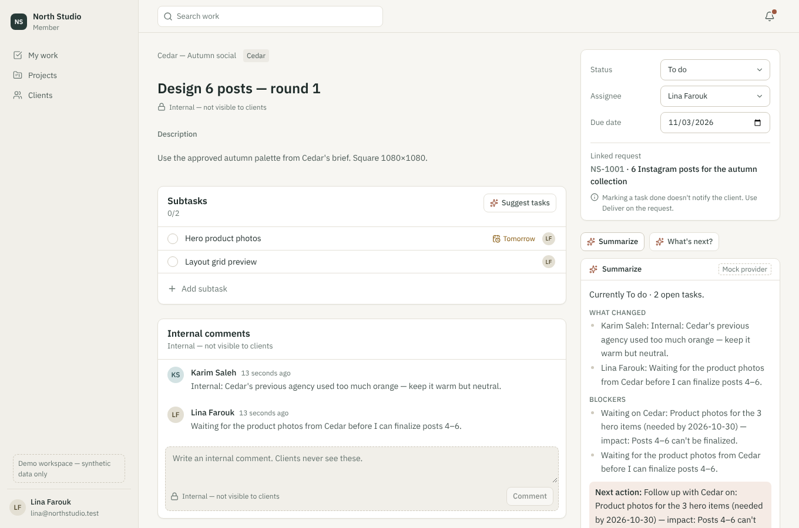

# Project Hub

**Requests in. Work organized. Clients informed. AI removes the busywork.**

A simple, AI-native, multi-tenant work and request manager for internal service teams, agencies and small teams — one app, two modes:

- **Simple Work** — projects, tasks, subtasks, owners, due dates, internal comments, files, notifications.
- **Requests + Work** — a five-question request portal, triage inbox, task breakdown, client conversation, versioned deliverables, explicit **Deliver**, approvals, optional SLA and optional SMS.

Arabic (RTL) and English (LTR) throughout, light and dark themes, responsive down to phone width.



---

## Quick start (local)

Requirements: Node 20.9+ (22 recommended), PostgreSQL 15+ (16 tested).

```bash
cp .env.example .env            # then set real local passwords + APP_SECRET
npm install
npm run db:setup                # creates the owner + app roles and the database (uses DATABASE_ADMIN_URL)
npm run db:migrate              # schema, Row-Level Security policies, grants
npm run db:seed                 # synthetic demo data (refuses to run in production)
npm run dev:all                 # web app on :3000 + background worker
```

Open http://localhost:3000 — every demo account uses the password **`demo-password-2026`**.
Mock email/SMS appear at http://localhost:3000/dev/mailbox (development only).

| Account | Workspace / role |
|---|---|
| `demo@projecthub.test` | All three workspaces (admin/manager) — shows the workspace switcher |
| `karim@northstudio.test` | North Studio (fictional agency) — manager |
| `lina@northstudio.test` | North Studio — member (designer) |
| `sara@cedar.test` | Client **Cedar** contact (can approve) |
| `adam@river.test` | Client **River** contact |
| `huda@jazeera-pilot.test` | Jazeera Pilot — marketing manager (Arabic UI) |
| `khalid@sales.jazeera-pilot.test` | Jazeera Pilot — Sales requester (Arabic UI) |
| `dana@smallteam.test` | Small Team Studio — Simple Work owner |

All seed data is synthetic. The Jazeera Pilot workspace uses only the confirmed brand color token (`#124734`); no logo, fonts, employee data or documents are included.

## Demo scenarios (spec §A7)

1. **Jazeera (synthetic)** — as `khalid@…` open *New request → Campaign*, write informally in Arabic, try *تحسين بالذكاء الاصطناعي*, send. As `huda@…` triage it in **Inbox** (owner + committed date), open *Internal work* → *Suggest tasks* → review → create, add a Procurement dependency, *Summarize* to see the real blocker, then **Deliver**. Khalid gets exactly one in-app + email notice; SMS is attempted only if Khalid opted in with a consented phone (mock provider).
2. **Agency** — `sara@cedar.test` requests, sees only Cedar. `adam@river.test` gets *Not found* for Cedar's URLs, search, exports, notifications and AI.
3. **Small team** — `dana@smallteam.test` works with projects/tasks only; Inbox, clients, SLA are hidden.
4. **Provider unavailable** — set `AI_FORCE_UNAVAILABLE=1` or `MOCK_EMAIL_FAIL=1`: AI shows a friendly message, email retries with backoff, and business actions still succeed.

## Commands

| Command | What it does |
|---|---|
| `npm run dev` / `npm run worker` / `npm run dev:all` | Web app, background worker, or both |
| `npm run build && npm start` | Production build/serve |
| `npm run typecheck` · `npm run lint` | TypeScript and ESLint |
| `npm test` | Integration tests on a fresh `projecthub_test` database (isolation, lifecycle, AI privacy, SLA, SMS) |
| `npm run test:e2e` | Playwright journeys (needs the dev DB seeded: `npm run db:reset`) |
| `npm run db:generate` | New migration from schema changes |
| `npm run db:reset` | Drop, migrate and reseed the local database |
| `scripts/backup.sh` / `scripts/restore.sh <file>` | Logical backup / restore (`pg_dump -Fc`) |

## Architecture

```
src/
  app/                 Next.js App Router pages, server actions, route handlers
    w/[slug]/…         Team workspace (Inbox, My work, Projects, Clients, Reports, Settings)
    portal/[slug]/…    Requester portal (Home, My requests, Approvals)
    api/files/…        Signed, permission-checked downloads
  components/          Design system (ui/), shell, work, requests, portal, ai
  i18n/                en.ts / ar.ts dictionaries, formatters (Gregorian calendar, Latin digits)
  server/
    db/                Drizzle schema + RLS-scoped transactions (withScope)
    services/          Domain services — every write goes through these
    ai/                Provider interface, mock + Anthropic adapters, context builder, schemas
    notify/            Outbox worker, matrix, email/SMS providers, SLA tick, digests
    sla/               Business-time arithmetic
drizzle/               SQL migrations (0001_security.sql = RLS policies + grants)
tests/                 Vitest integration tests against Postgres
e2e/                   Playwright journeys
```

Key decisions are in [IMPLEMENTATION_PLAN.md](IMPLEMENTATION_PLAN.md); permissions in [docs/permissions.md](docs/permissions.md).

**Isolation.** Tenant comes from the URL slug and a server-checked membership — never from form input. Every query runs in a transaction that sets `app.tenant_id / app.user_id / app.client_org_id`; Postgres RLS enforces tenant scope, client-org scope and staff-only tables as a second line behind the service-layer checks. The app's DB role cannot bypass RLS. Cross-object foreign keys are composite `(tenant_id, id)`.

**AI.** Four on-click features (Summarize, Improve brief, Suggest tasks, What's next). Context is built from what the actor can already read; untrusted text is fenced as data; outputs are Zod-validated drafts; evidence ids not present in the context are dropped; applying a draft goes through the same authorization as manual edits and is rejected if the source changed. Per-tenant toggles, monthly action/spend caps, per-person hourly limit, cached by context digest, logged without source text.

**Notifications.** Business transactions write to a transactional outbox; the worker fans out to in-app notifications and email/SMS deliveries with idempotency keys, retries with backoff and a dead-letter state. A provider failure never rolls back a request/task change.

## Status (first release)

| | |
|---|---|
| **Done** | Multi-tenant auth (password + magic link + invitations), RLS isolation, design system (AR/EN, light/dark, mobile), projects/tasks/subtasks/comments/files, board view, 5-field intake with presets and conditional follow-ups, triage (accept/needs info/decline), requested vs committed dates, dependencies, versioned delivery + approvals/revisions + review-window auto-close, in-app notifications + preferences + digests, SLA (business calendar, pause rules, warnings/breaches), reports + CSV, search, audit log, settings (branding with contrast-safe colors, logo, team, request types, SLA, notifications, AI), four AI features with apply/dismiss, quotas and logging |
| **Mocked** | AI provider (deterministic mock by default; Anthropic adapter ready behind `AI_PROVIDER=anthropic` + key), email (dev mailbox; SMTP adapter ready), SMS (mock only), virus scanning (placeholder marks files clean) |
| **Not done** | Down-migrations (restore from backup instead), S3 storage driver (interface only), SSO/Entra, AI draft-reply & brand-kit UI (schema only), billing, guest invitation expiry UI, drag-and-drop board |
| **Blocked** | Real AI key + vendor terms; verified email domain; SMS provider + Saudi sender registration + consent policy; Jazeera logo/Arboria font rights and legal approval for production data; hosting/residency/PDPL decisions |

See [docs/deployment-checklist.md](docs/deployment-checklist.md) before any non-local deployment.
